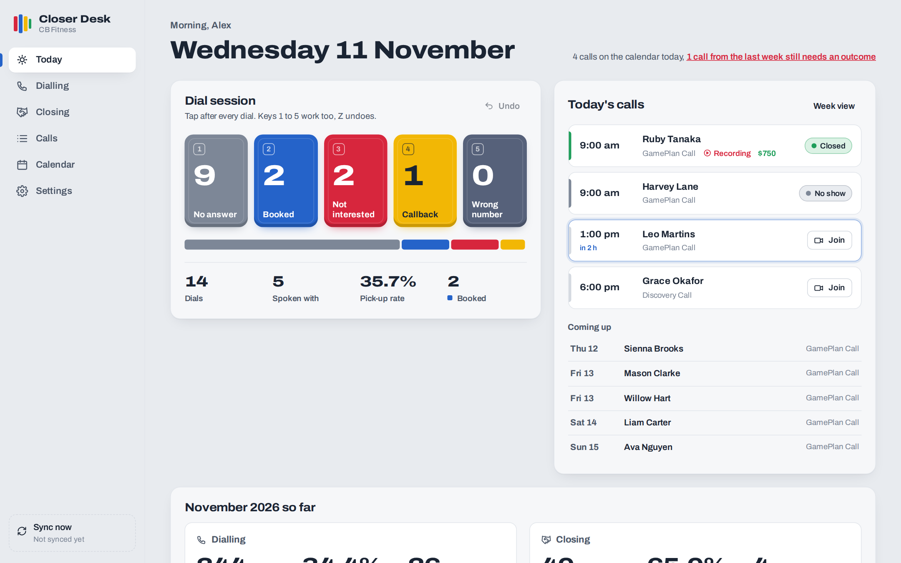
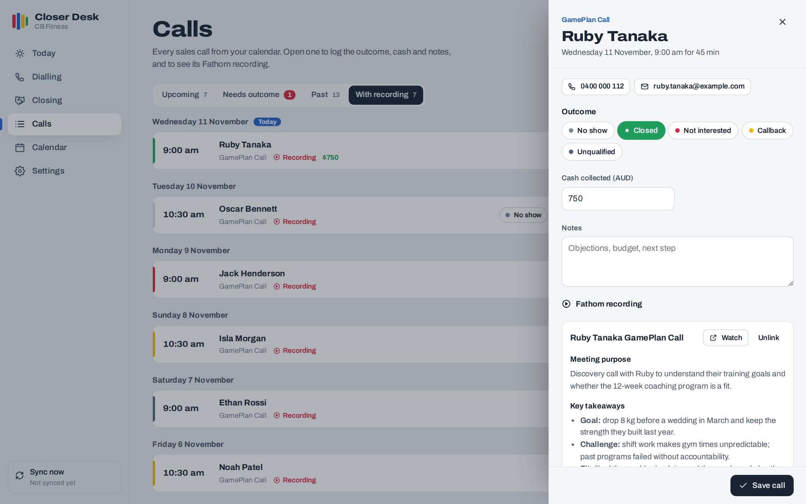
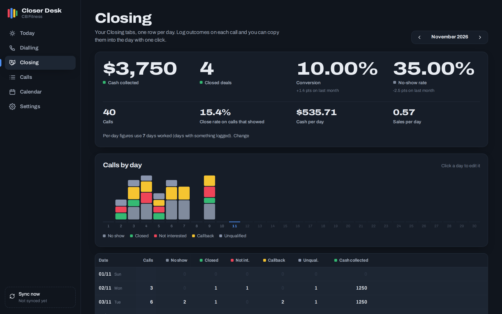
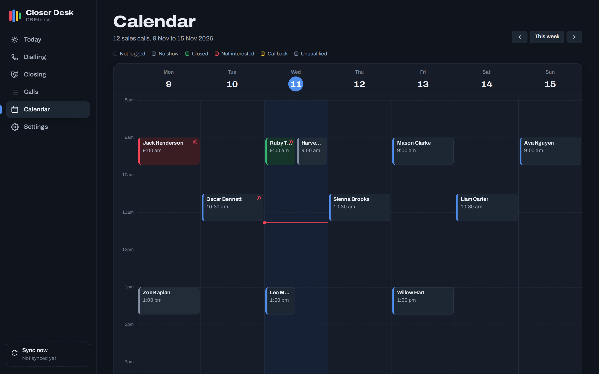

# Closer Desk

A sales tracker for SDRs and closers who are tired of typing dial counts into a spreadsheet mid-session.

I built it for my own appointment-setting and closing work at a fitness coaching business. It replaces the Google Sheet I used to log every day. It also connects the parts the sheet never could: my calendar, my call recordings and my numbers.

Built with an AI coding agent, then deployed to my homelab in a container of its own.



## What it does

- **One-tap dial counter.** Five big buttons for the outcome of each dial: no answer, booked, not interested, callback, wrong number. Keys 1 to 5 work mid-session, and Z undoes. Totals, spoken-with and pick-up rate update as you go.
- **Daily logs for dialling and closing.** One editable row per day, in the same layout as the spreadsheet it replaced. Totals and rates are worked out with the same formulas the sheet used, so the numbers match.
- **Calls pulled from Google Calendar.** Any event whose title matches your keywords (for example "Discovery Call") becomes a call, with the lead's name, phone, email and join link.
- **Fathom recordings attached to each call.** Recordings are matched by meeting link, title or guest email. Each call shows the AI summary and action items, with a link to watch.
- **Outcomes per call, rolled into the day.** Log no-show, closed, not interested, callback or unqualified on each call. One click copies them into that day's closing tally.
- **Week calendar.** Each call is coloured by its outcome, so you can see at a glance which calls are still unlogged.



| Closing (dark mode) | Calendar (dark mode) |
| --- | --- |
|  |  |

## The numbers it tracks

| Dialling | Closing |
| --- | --- |
| Total leads = no answer + booked + not interested + callback + wrong number | Calls = no show + closed + not interested + callback + unqualified |
| Pick-up rate = spoken with ÷ total leads | Conversion = closed ÷ calls |
| Booking rate = booked ÷ total leads | No-show rate = no shows ÷ calls |
| Bookings per lead spoken to | Close rate on calls that showed |
| Bookings and dials per day worked | Cash collected, cash per day and sales per day |

"Days worked" defaults to the days with something logged. You can override it for each month.

## Stack

- SvelteKit 2 and Svelte 5 with runes, served by `adapter-node`
- SQLite through `better-sqlite3`
- Google Calendar API (OAuth refresh token, read only) and the Fathom external API
- No UI framework. The design is "bumper plates on chalk": one variable font (Archivo, using its width axis for the scoreboard numbers), with outcome colours borrowed from competition weight plates.
- Light and dark themes, works on a phone, and respects reduced-motion settings

## Run it

```bash
npm install
cp .env.example .env   # optional: add Google + Fathom credentials
npm run dev
```

Try it with made-up data and no accounts connected:

```bash
DATA_DIR=demo-data node scripts/demo-seed.js
DATA_DIR=demo-data NO_SYNC=1 npm run dev
```

Production build: `npm run build`, then `node build`. Set `PORT`, `HOST` and `DATA_DIR` as needed. `deploy/` has the systemd unit and the script I use to ship it to a Proxmox LXC container.

## Configuration

| Variable | Purpose |
| --- | --- |
| `GOOGLE_CLIENT_ID`, `GOOGLE_CLIENT_SECRET`, `GOOGLE_REFRESH_TOKEN` | Read your primary Google Calendar |
| `FATHOM_API_KEY` | Pull recordings, summaries and action items |
| `OWNER_NAME` | Name used in the greeting on the Today page |
| `DATA_DIR` | Where the SQLite database lives (default `./data`) |
| `NO_SYNC` | Set to turn off the 10-minute background sync |

The keywords that decide which calendar events count as sales calls are set in the app, under Settings.

All names, phone numbers and figures in the screenshots are made up.
